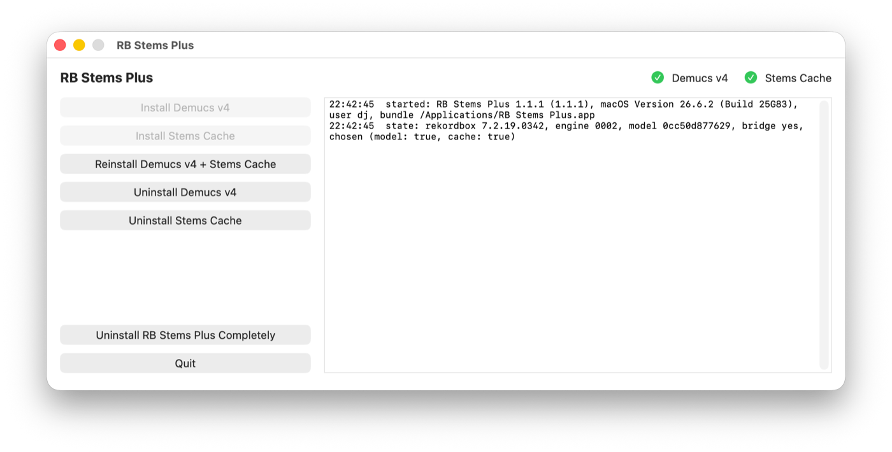
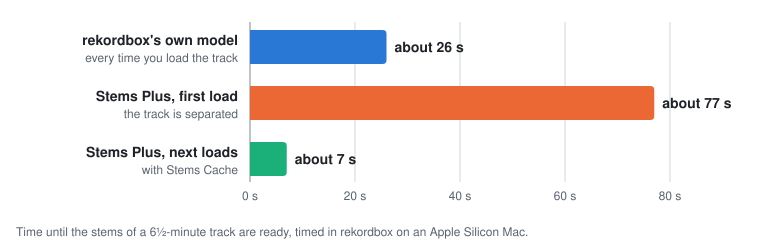
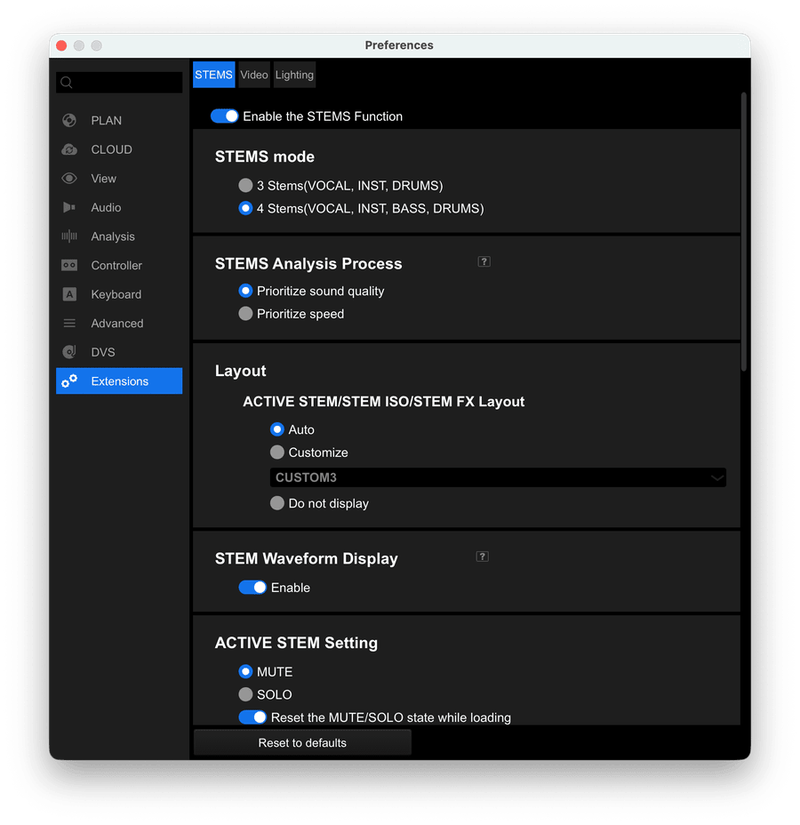
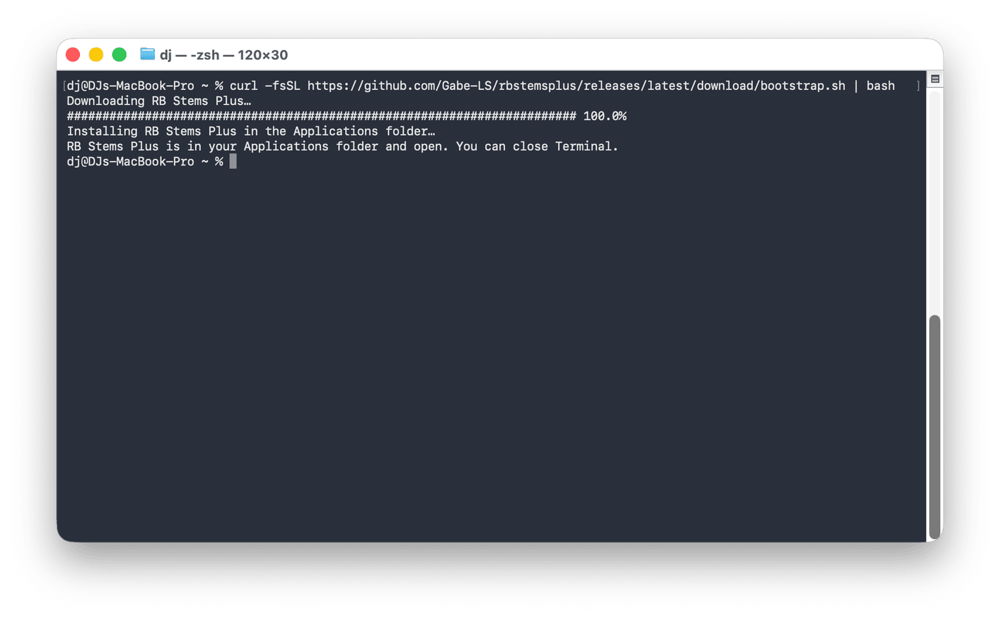
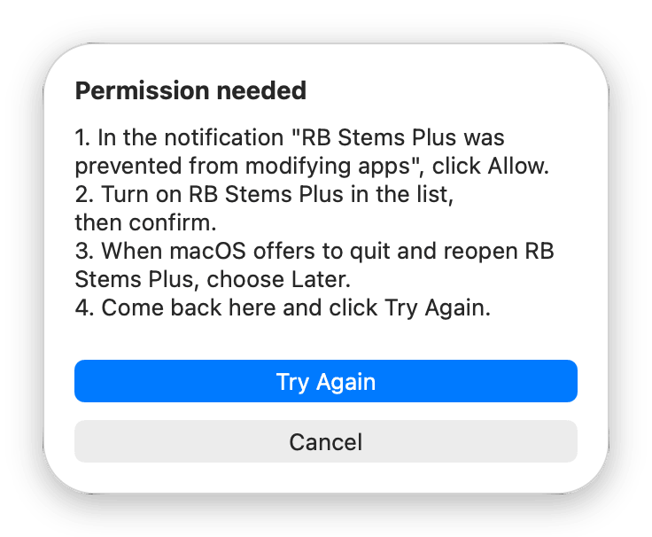
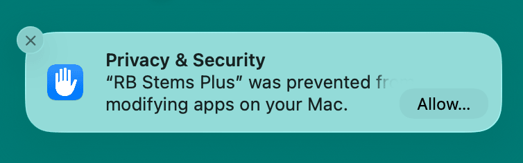
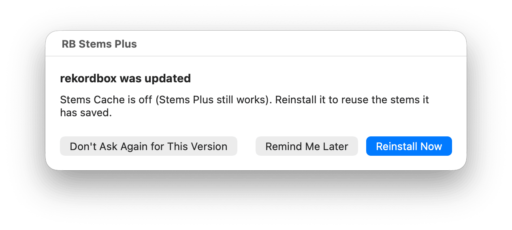
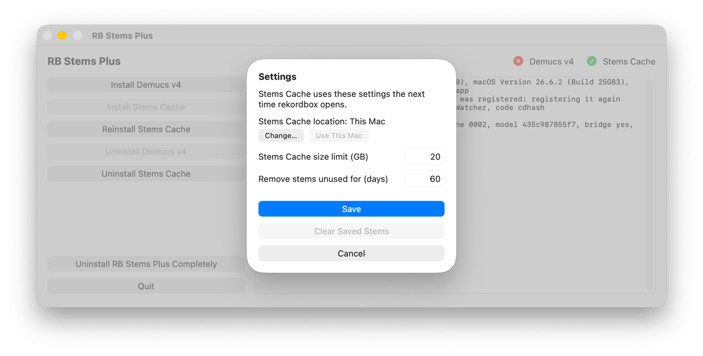
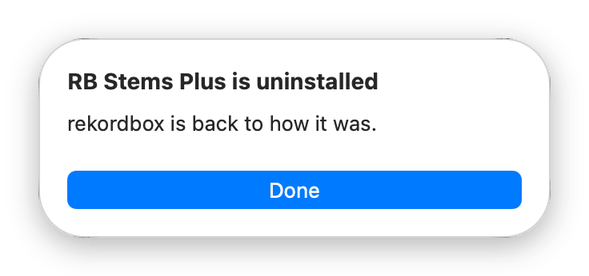

# RB Stems Plus

**A different stems model and much faster reloads for rekordbox's STEMS, on Mac and Windows.**
Free and open source.

[What it does](#what-it-does) · [What you get](#what-you-get) · [Install on Mac](#install) ·
[Windows](#windows) ·
[FAQ](#faq) · [Troubleshooting](docs/troubleshooting.md) · [Get help](#get-help)



## What it does

**Stems** are the parts of a track pulled apart: vocals, drums, bass and the rest of the music
(rekordbox calls it Inst). With STEMS in rekordbox you can mute or solo each part live, for
example drop the vocals for an instrumental or keep only the vocals for an acapella. rekordbox
works the stems out on your computer with a "model": a program trained to tell the parts apart.

RB Stems Plus is a small app with two features:

- **Demucs v4: a different stems model.** It swaps rekordbox's model for Meta's Demucs v4, the
  newer version of the open source separation model that rekordbox's own is based on. It doesn't
  change the rekordbox app.
- **Stems Cache: much faster reloads.** rekordbox separates a track again every time you load
  it. Stems Cache keeps the stems it already made, so the next time you load that track they
  come back in seconds, without separating the track again. It works with either model,
  rekordbox's own or Demucs v4, and it changes one file inside rekordbox (see
  [Honest risks](#honest-risks)).

Install either one, or both. With Stems Cache on Windows or an Apple silicon Mac, you can also
[prepare a playlist](#prepare-playlists-before-a-set) before a set so its tracks load with
their stems.

## What you get

### Which model sounds better? It depends on your music

rekordbox's own model is Demucs v3, retuned by Pioneer. Demucs v4 is Meta's newer version. They
split some sounds differently, and which split is better depends on the music, and on the stem:

- **Pop, rock and rap:** on MUSDB18, a standard test of 50 songs with their real stems, Demucs v4
  came closer to the real stems on every stem: bass on 45 of 50 songs, drums on 44, the rest of
  the music on 41, vocals on 36.
- **Electronic tracks:** on six electronic productions with their producers' stems, Demucs v4 was
  closer on drums and bass (about 2.5 dB at the median, roughly 40% less bleed), and rekordbox's
  model on vocals and the rest of the music. Not on every track: one went to rekordbox's model on
  bass too.
- **Rumble techno:** on *Lunfardo* by Ignez, rekordbox's model keeps a short low note before each
  kick in the bass stem. Demucs v4 puts it in the drums until the track opens up, and to our
  ears rekordbox's split was closer. We tried many other models on the same minute and got
  different results from each:
  - Meta's htdemucs (the same model, run outside rekordbox), htdemucs_ft and mdx_extra, and
    ZFTurbo's SCNet and BS-RoFormer did the same;
  - Demucs v4's six-stem version and Meta's original Demucs v3 caught part of it;
  - AudioShake and Ableton Live's stem separation each made yet another split.
- **Synthetic techno loops with known stems:** close. With a held sub bass Demucs v4 came closer
  on average. With short rolling bass notes both did much worse, and rekordbox's model was
  slightly closer on 5 of 8 loops.

So try both on your own tracks and keep the one you like. **Uninstall Demucs v4** puts rekordbox's
model back any time, and **Install Demucs v4** brings it back. Stems Cache works with both and
keeps the stems saved with each.

### Faster reloads, and the price

Demucs v4 does more work, so the first STEMS on a track takes longer. Stems Cache saves the stems
once a track is separated, with either model, so every later load is much faster.

<picture>
  <source media="(prefers-color-scheme: dark)" srcset="docs/images/stems-load-time-dark.svg">
  
</picture>

Timed in rekordbox on an Apple Silicon Mac, from loading a 6½-minute track to its stems being
ready. Demucs v4 separates about 5 times faster than the music plays, rekordbox's own model
about 15 times.

**Memory:** rekordbox's own model uses about 1.42 GB at its peak. The Demucs v4 model, run
with rekordbox's usual settings, peaks at about 2.30 GB. With Stems Cache installed it runs with
a leaner setting and peaks at about 1.52 GB, with the same speed and the same stems.

## Windows

You need Windows 11 version 22H2 or later on an x64 or ARM64 PC and .NET Framework 4.8.1 or
later. Stems Cache supports rekordbox 7.2.19 and 7.2.20. Turn on STEMS in rekordbox once so it
downloads its STEMS Engine. In **Preferences › Extensions › STEMS**, choose
**Prioritize sound quality**.

1. **Quit rekordbox.** Open PowerShell from the Start menu as a normal user, paste the line
   below and press Enter.

   ```powershell
   irm https://github.com/Gabe-LS/rbstemsplus/releases/latest/download/bootstrap.ps1 | iex
   ```

2. RB Stems Plus opens and is available from the Start menu. Click **Install Stems Cache**,
   **Install Demucs v4**, or both, one at a time. One Stems Cache install and one Windows
   administrator prompt cover all versions that are ready to install.

The Windows app has a light appearance only in 1.5.0. Stems Cache defaults to **This PC**. You
can choose an external drive in [Settings](#settings).

Open **View › Prepare** to make stems for supported playlist tracks in advance. The **Status**
tab shows prepared playlists. See [Which files can Windows prepare?](#which-files-can-windows-prepare).

See [Windows troubleshooting](docs/troubleshooting.md#windows) for install messages and help
putting rekordbox's original files back.

### Several versions of rekordbox on Windows

rekordbox installs new versions alongside older ones. Stems Cache works in every supported
version you have installed. When you have several versions, **Manage** shows one row for each
version. Check the row for its state and what to do next.

If you already use Stems Cache, RB Stems Plus checks new versions automatically. Once a version
is ready, it asks if you want to add Stems Cache to it. Choose **Install Now**, or open **Manage**
later and click **Install Stems Cache**.

## Before you install

- **A Mac.** Tested on macOS 26 Tahoe on an Apple Silicon Mac. Older versions, from macOS 12,
  should work but are untested, and so should Intel Macs (untested too; preparing playlists needs
  Apple silicon).
- **rekordbox 7** in `/Applications/rekordbox 7`, with STEMS working, and turned on at least
  once so rekordbox has downloaded its **STEMS Engine** (the files STEMS needs).
- **An administrator account** on the Mac (the one that can install apps), for Stems Cache.
- **Disk space:** about 1.5 GB for RB Stems Plus (the model, a spare copy, and the copies of
  rekordbox's files it keeps so it can put them back). The app checks first and says if it
  needs more. Then room for saved stems: at most 20 GB by default, which you can change.

Stems Cache stops saving new stems when your disk gets low: under 10% of the disk free, 50 GB
at most (about 25 GB on a 256 GB Mac). Stems it already saved still load.

Where to find STEMS in rekordbox: **Preferences › Extensions › STEMS**, with **Enable the STEMS
Function** on. On the same page, **STEMS Analysis Process** must be **Prioritize sound
quality**: with **Prioritize speed**, rekordbox separates with a different, faster engine, so
Demucs v4 isn't used and Stems Cache saves nothing.



## Install

1. **Quit rekordbox.**
2. **Open Terminal** (press Cmd+Space, type *Terminal*, press Return), paste this line and press
   Return:

   ```sh
   curl -fsSL https://github.com/Gabe-LS/rbstemsplus/releases/latest/download/bootstrap.sh | bash
   ```

   It puts **RB Stems Plus** in your Applications folder and opens it. You can close Terminal.

   

3. **Click Install Stems Cache, Install Demucs v4, or both, one after the other** (after
   **Continue** on the welcome message), and **Install** to confirm each. If a button is greyed
   out, the line under the buttons says why (see [Troubleshooting](docs/troubleshooting.md)).
   - **Demucs v4** downloads the model (about 300 MB) and puts it in place. No password.
   - **Stems Cache** needs your password and, the first time, macOS's permission (steps 4
     and 5).
4. **Type your password** when it asks (*Password needed*), then click **Continue**.
5. **The first time only, allow RB Stems Plus in macOS.** macOS says *"RB Stems Plus was
   prevented from modifying apps"*, and the app shows you these steps:
   1. In the notification, click **Allow**.
   2. Turn on **RB Stems Plus** in the list, then confirm.
   3. When macOS offers to quit and reopen RB Stems Plus, choose **Later**.
   4. Back in RB Stems Plus, click **Try Again**.

    

   Installing Stems Cache takes about a minute. When the light of what you installed is green,
   you're done.
6. **Open rekordbox, load a track and turn on STEMS.** With Demucs v4 the first time takes
   longer than before. Load it again later: with Stems Cache it's much faster.

**Changed your mind?** Each feature can be added or removed on its own any time.

### What else you'll see

- **A notice that "RB Stems Plus Watcher" can run in the background.** That's RB Stems Plus's
  small helper that tells you when a rekordbox update needs a reinstall. It only asks, it never
  changes anything by itself.
- **With Stems Cache, at every rekordbox update:** macOS says *"rekordbox was prevented from
  modifying apps"*. Click **Allow** so the update can finish. This is expected: Stems Cache
  re-signs rekordbox on your Mac, so macOS asks before Pioneer's updater replaces it.
- **macOS asks again for RB Stems Plus** after RB Stems Plus updates itself, the next time it
  installs, reinstalls or removes Stems Cache. Same steps as above.
- **Sometimes macOS doesn't ask at all,** for example right after rekordbox was installed or
  updated. That's normal.

### The lights

The window has three tabs: **Status** (the two features and your prepared playlists),
**Prepare** and **Manage** (each feature's buttons and the log). The two lights on the Status tab
show each feature: a **green check** means it's on, a **red cross**
means it's off. Stems Cache's light turns **yellow** when it's installed but not saving stems
right now, for example when the disk is low or rekordbox has a STEMS Engine that Stems Cache
doesn't support yet: the line under it says why. Anything that can't be installed is explained
in the line under the buttons on the Manage tab.

## After a rekordbox update

On Windows, see [Several versions of rekordbox on Windows](#several-versions-of-rekordbox-on-windows).

### On Mac

- **A rekordbox update** puts Pioneer's original rekordbox back, so Stems Cache is off until you
  reinstall it. Demucs v4 keeps working, and your saved stems are kept.
- **A new STEMS Engine** puts rekordbox's own model back, so Demucs v4 is off. Stems Cache goes
  on saving stems if it supports that STEMS Engine; if not yet, its light turns yellow until
  an RB Stems Plus update does.

When the update is done and rekordbox is closed, RB Stems Plus asks: **Reinstall Now**,
**Remind Me Later** or **Don't Ask Again for This Version**. **Reinstall Now** opens the app and
reinstalls only what went missing. Or open the app any time and, on the **Manage** tab, click
**Install** for the part whose light is red.

If RB Stems Plus doesn't support the new version yet, it says so instead, checks again each time
you open it, and asks you to reinstall once it can.



## Updating RB Stems Plus

When you open it, RB Stems Plus checks (at most once a day) for a newer version. If there is
one, the line under the buttons says *"RB Stems Plus X is available"*, and **Update RB Stems
Plus** appears in the RB Stems Plus menu. The new version replaces the old one in one step. If
the update can't finish, RB Stems Plus stays as it was and tells you why the next time it opens.

When an update includes a new Stems Cache, RB Stems Plus asks when it opens. Quit rekordbox
before clicking **Update**. Windows asks for an administrator's permission, and macOS asks for
your password. **Not Now** keeps using the installed Stems Cache, and the app asks again the
next time it opens.

## Settings

**RB Stems Plus › Settings…** (Cmd+, on Mac) sets how much space saved stems may use (20 GB by
default) and after how many days unused stems are removed (60 by default). They apply the next
time rekordbox opens. **Clear Saved Stems** frees the space now.

Saved stems take about 13 MB per minute of music with Demucs v4 and about 16 with rekordbox's own
model: 1 GB holds about 85 or 65 minutes on this Mac.

**On Windows,** close rekordbox and click **Change…** next to *Stems Cache location*. Choose a
folder on an external drive formatted as NTFS, exFAT or FAT32. Stems Cache can reuse stems already
saved on the drive and normally removes the stems saved on this PC when you switch.
**Use This PC** switches back and leaves the drive's stems on it. See
[Stems Cache location on Windows](docs/troubleshooting.md#stems-cache-location-on-windows).

**On Mac,** stems are saved on this Mac by default. To use an external drive, click **Change…**
next to *Stems Cache location*, choose the drive (or a folder on it), and RB Stems Plus makes a
folder named *RB Stems Plus Cache* there. Switching starts empty: the stems saved on this Mac are
deleted, and rekordbox separates those tracks again the next time you load them. If the drive
already holds saved stems (from this Mac, another Mac or another account), they're used.
**Use This Mac** goes back; the drive's stems stay on it. Without the drive, rekordbox separates
tracks as usual; connect it, also while rekordbox runs, and it's used again within seconds. Quit
rekordbox and eject the drive before unplugging it. More in [Troubleshooting](docs/troubleshooting.md#saved-stems-on-another-drive).



## Prepare playlists before a set

With Stems Cache installed, the **Prepare** tab makes stems for supported playlist tracks on
Windows and Apple silicon Macs. The tracks load with their stems as if you had loaded them before.

### Which files can Windows prepare?

- **File types.** MP3, WAV, AIFF (`.aif` or `.aiff`), FLAC (`.flac` or `.fla`), and M4A or MP4
  with AAC or Apple Lossless audio. Prepare skips raw `.aac` files and 64-bit float WAV. It also
  skips 20-bit and 32-bit Apple Lossless (ALAC). If a skipped track supports STEMS in rekordbox,
  you can still separate it there.
- **Sample rates.** Supported audio that decodes at 44.1 kHz, including mono and stereo AAC. When
  the app can verify sample rate conversion for your rekordbox build, it also accepts:
  - MP3 at 16, 22.05, 24, 32 and 48 kHz, constant or variable bitrate, mono or stereo.
  - WAV, FLAC, AIFF and Apple Lossless at 22.05, 48 and 96 kHz, and mono or stereo at 88.2 and
    192 kHz (Apple Lossless in M4A).
  - AAC-LC in M4A or MP4: stereo at 16, 22.05, 24 and 32 kHz, mono at 32 kHz, and mono or
    stereo at 48 kHz.

  Prepare skips other rates and files at rates rekordbox can't load. That includes mono AAC-LC
  at 16, 22.05 and 24 kHz, and WAV, FLAC, AIFF and Apple Lossless at 16, 24 and 32 kHz.
- **MP4 with several audio tracks.** Prepare uses the audio track rekordbox uses when it can
  identify it. If it can't, it skips the file.

In 1.5.0, Windows Prepare runs Demucs v4 on the CPU only. If Prepare skips a track, check the
reason on the **Prepare** tab. See
[Prepare skips a track on Windows](docs/troubleshooting.md#prepare-skips-a-track-on-windows).

### Preparing on Mac

1. Choose a playlist on the left (rekordbox's own list, read only). RB Stems Plus says how many
   tracks are ready, how many it will prepare, how much space and about how long it takes.
2. Choose until when to keep them (10 days by default), then click **Prepare**. You can keep
   using your Mac, and rekordbox, meanwhile: it works in the background. **Pause** and **Stop**
   are there and in the Prepare menu; what is done stays done.
3. The **Status** tab lists your prepared playlists (5 at most) and says whether each one is still
   ready. When you open rekordbox, RB Stems Plus checks them too, and tells you with a
   notification, once, if one needs preparing again (a track was added, or a file was changed,
   moved or deleted). New tracks aren't prepared by themselves: click **Prepare** again. The files
   of tracks on another drive or in your Documents, Desktop, Downloads or a cloud folder, and stems
   saved on another drive, aren't looked at then, because macOS would ask over rekordbox: look at
   the Status tab before a set. With RB Stems Plus Watcher turned off nothing is checked when rekordbox opens.


Good to know:
- Prepared stems are kept until their date: Stems Cache doesn't remove them meanwhile, unless you
  lower its size limit below them. That holds for your account only: another account or Mac using
  the same folder on a drive can remove them under its own limits. They may
  use up to 75% of Stems Cache's size limit, so there's room left for the tracks you load during
  the set. A playlist that doesn't fit can be prepared in part, or the limit raised.
- They take about 13 MB per minute of music with Demucs v4 and about 16 with rekordbox's own model
  (AAC files up to twice that), and a minute of music takes about 10 to 15 seconds to prepare.
- Tracks in your Documents, Desktop or Downloads folder: macOS asks once whether RB Stems Plus may
  read each of them. Click **Allow**. Missing files are skipped, and the list says why. Streaming
  tracks are left alone.
- rekordbox must be set to *Prioritize sound quality* for STEMS (Preferences › Extensions ›
  STEMS): prepared stems aren't used with *Prioritize speed*.

## Uninstall

Open RB Stems Plus's **Manage** tab (or the Manage menu) and click:
- **Uninstall Stems Cache:** rekordbox gets Pioneer's original files back, byte for byte.
  On Windows, this applies to each affected version of rekordbox.
- **Uninstall Demucs v4:** rekordbox gets its own stems model back. Stems Cache, if you have it,
  goes on saving stems with that model.
- **RB Stems Plus › Uninstall RB Stems Plus…** (in the menu bar): rekordbox goes back to exactly
  how it was, and RB Stems Plus deletes itself, its settings, its logs and the stems it saved, removes its App
  Management and Files and Folders permissions, and takes its icon out of the Dock if you kept
  it there. macOS may keep its entries in System Settings › Notifications.

Your music and your rekordbox library are never touched. The complete uninstall ends with this:



## Honest risks

- **It's unofficial.** AlphaTheta doesn't know about it or support it. A future rekordbox could
  change how STEMS works. RB Stems Plus then leaves rekordbox on its own model until it's
  updated.
- **It changes rekordbox's files.** Demucs v4 replaces rekordbox's model file. Stems Cache
  replaces one file inside rekordbox.app and re-signs the app on your Mac, so while it's
  installed rekordbox is no longer signed by AlphaTheta. Pioneer's originals are kept, and
  uninstalling puts everything back. Reinstalling rekordbox from rekordbox.com also always gives
  you Pioneer's app.
- **rekordbox's licence (EULA) doesn't allow modifying the program.** Stems Cache clearly does,
  and swapping the model arguably does too. In our tests rekordbox sent nothing about it, but we
  can't promise that stays true. If you contact AlphaTheta support, uninstall first.
- **No warranty.** It's free software under the MIT licence, provided as is.
- **Never try new software for the first time at a gig.**

## Privacy and security

- **Nothing is sent anywhere.** No tracking, no accounts. RB Stems Plus only goes online to
  download its own files from this project's GitHub Releases.
- **Releases are signed.** Each release comes with a signed list of its files. The install
  command and the app check that signature, and each file's checksum (a fingerprint of the
  file), before using anything.
- **Logs stay on your Mac** (`~/Library/Logs/rbstemsplus`). They never contain your audio or
  track names.
- **The Prepare tab reads rekordbox's library and your music files** (read only, to list your
  playlists and to check and prepare their tracks), and so do the Status tab and the check when
  rekordbox opens if you have prepared playlists. Neither is ever changed.
- **A problem report is never sent automatically.** You make it and attach it yourself (see
  [Get help](#get-help)).

## FAQ

**Is it free? What's the catch?** Free and open source (MIT licence). The catch is in
[Honest risks](#honest-risks): it's unofficial, and Stems Cache changes one file in rekordbox.

**Is it safe to paste a command into Terminal?** The line downloads a short script from this
project's GitHub Releases. It checks every file against the release's signed list before it
puts the app in Applications. You can [read it first](scripts/bootstrap.sh).

**Why a command instead of a normal download?** Apps downloaded in a browser from developers
without a paid Apple account trigger macOS's "damaged" or "unidentified developer" warnings.
The command avoids them.

**Will it break rekordbox?** Demucs v4 swaps only the model file. Stems Cache replaces one file
inside rekordbox and keeps Pioneer's original, which uninstalling puts back. If anything goes
wrong, reinstalling rekordbox from rekordbox.com gives you Pioneer's app again.

**Will it touch my library, playlists, cues or music?** It never changes them. The Prepare tab
reads rekordbox's library and the tracks' files, read only. If you have prepared playlists, the
Status tab does the same, and the check when rekordbox opens reads the library and looks at the
files' sizes and dates. Uninstalling doesn't touch them either.

**Is it allowed? Can AlphaTheta ban my account?** It unlocks nothing you don't already have.
But rekordbox's licence doesn't allow modifying the program, and Stems Cache does. In our tests
rekordbox sent nothing about it. See [Honest risks](#honest-risks).

**Which rekordbox plan do I need?** One rule answers this and the next few questions: **if STEMS
works in your rekordbox, RB Stems Plus works with it. If it doesn't, RB Stems Plus can't add
it.**

**Does it work with my controller, CDJs or USB exports?** RB Stems Plus only changes the
separation done inside rekordbox on your Mac. A controller just controls rekordbox, so it gets
the Demucs v4 stems. It doesn't touch USB exports, CDJs or any other hardware.

**Does it work with streaming tracks?** No. rekordbox doesn't separate streaming tracks, so STEMS,
and RB Stems Plus with it, works only on tracks you have as files.

**Which rekordbox versions work?** Stems Cache in 1.5.0 supports rekordbox 7.2.17, 7.2.18,
7.2.19 and 7.2.20 on Mac, and 7.2.19 and 7.2.20 on Windows. Demucs v4 works with the STEMS
Engine versions RB Stems Plus knows. The app checks for updates to the list and tells you if
your version isn't on it.

**Which Macs? Windows?** See [Before you install](#before-you-install) for Mac and
[Windows](#windows) for PC requirements.

**Do I need both features?** No. Each works on its own: Demucs v4 changes the model, Stems Cache
saves the stems of whichever model rekordbox uses. Install one, both, or add the other later.

**Will my tracks sound better?** It depends on your music: see
[Which model sounds better?](#which-model-sounds-better-it-depends-on-your-music). If you prefer
rekordbox's model, **Uninstall Demucs v4** brings it back any time.

**Does it work offline, at a gig?** Yes. Separating tracks and loading saved stems happen on
your Mac, with no internet needed (we tested it with the network off).
Installing needs internet. Reinstalling works offline from the files already on your Mac (for
Stems Cache, only if they were downloaded in the last 7 days).

**Can I prepare my tracks before a gig?** Yes: [prepare the playlist](#prepare-playlists-before-a-set)
and its stems are ready and kept until a date you choose. On an Intel Mac, load each track once with
STEMS on and let rekordbox separate it: Stems Cache saves the stems. Stems unused for 60 days are
removed, which you can change in [Settings](#settings).

**Do saved stems survive restarts, updates, renaming or moving tracks?** Yes. They stay until
the size limit, the day limit or **Clear Saved Stems** removes them. They're found by the audio
itself, so renaming, re-tagging or moving a track (or the whole drive) doesn't matter. After a
rekordbox update on Mac, reinstall Stems Cache to use them again. On Windows, add Stems Cache
to the new rekordbox version to use them there. Stems saved with one model are used only with
that model: switch back and they load again.

**Does it change BPM, key, waveforms or analysis?** No. Only the stems model changes.
Everything else rekordbox does runs on its own files, unchanged.

**Does the app need to stay open?** No, except while a playlist is being prepared. **RB Stems
Plus Watcher** runs in the background and checks for new versions of rekordbox. On Mac, if you
turn it off (System Settings › General › Login Items & Extensions), the app says *"Reinstall
reminders are off"*. Open the app after rekordbox updates and check the **Status** tab before a set.

**Do I have to reinstall after every rekordbox update?** On Mac, RB Stems Plus asks you to
reinstall Stems Cache after a rekordbox update. On Windows, it offers to add Stems Cache to
the new version when it's ready. Demucs v4 survives rekordbox updates, but not a new STEMS
Engine download.

**Can I change how much space saved stems use?** Yes, in [Settings](#settings). The limit counts
the space the stems take on the disk. On this Mac they're in `~/Library/Caches/rbstemsplus`.
Don't move that folder or replace it with a link: to save them elsewhere, use Settings.

**Can I keep saved stems on an external drive?** Yes. Use **Change…** next to *Stems Cache
location* in [Settings](#settings). On Mac, use drives that macOS lists as external
(USB drives, most Thunderbolt drives), not network drives or a second internal disk. While the
drive isn't connected, rekordbox separates tracks as usual and nothing is saved. On an exFAT or FAT32 drive macOS adds a small hidden file next to each
saved file, so 1 GB holds about 72 minutes with Demucs v4 on a drive like an exFAT one with 128 KB clusters.
Loading from a hard disk is slower than the 7 seconds measured on this Mac's own disk.

Anyone who can write to that drive (another account, another Mac, any computer you plug it
into) can change the saved stems rekordbox plays, for any track in your library, not only the
music on that drive. Use a drive you control.

**Something's wrong.** See [Troubleshooting](docs/troubleshooting.md), also in the app under
**Help › RB Stems Plus Troubleshooting**.

## Get help

Help happens in this project's [GitHub issues](https://github.com/Gabe-LS/rbstemsplus/issues).
You need a free GitHub account.

1. In RB Stems Plus, choose **Help › Create Report**. It saves a zip on your Desktop.
2. Click **Open GitHub Issue**. Your browser opens a new issue with the technical details already
   filled in, and Finder shows the zip.
3. Write what happened under *What happened?*, drag the zip into the issue, and submit it.

The report holds RB Stems Plus's logs and settings, the versions of macOS, rekordbox and RB Stems
Plus, and rekordbox's recent errors and crash reports. It never includes your library, your
music or track names, and your user name is replaced. More in
[Making a problem report](docs/troubleshooting.md#making-a-problem-report).

## Licence and credits

Made by Gabe-LS. MIT licence, see [LICENSE](LICENSE). The Demucs v4 model is Meta's htdemucs (MIT).
Stems Cache includes libFLAC (BSD-3-Clause) and uses rekordbox's own ONNX Runtime. Full credits in
[NOTICE](NOTICE).

rekordbox, Pioneer DJ and AlphaTheta are trademarks of AlphaTheta Corporation. RB Stems Plus is
not made, endorsed or supported by AlphaTheta or Pioneer DJ.
